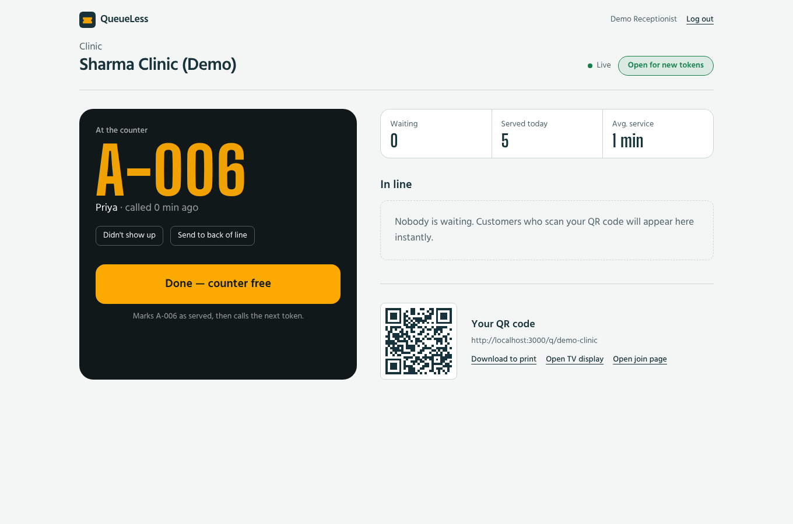
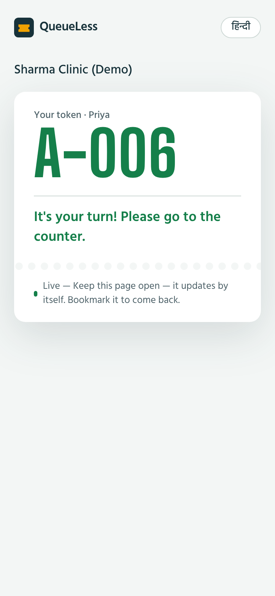
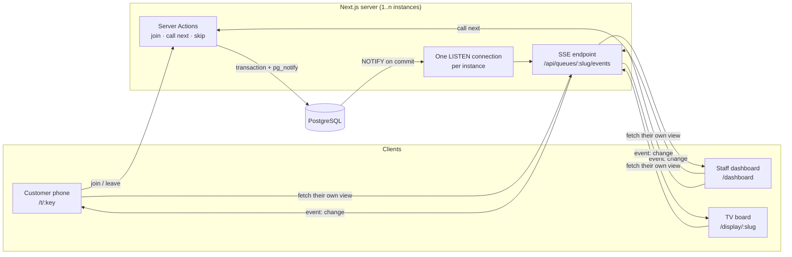

# QueueLess

A real-time virtual queue for clinics, salons and service counters in India.

Customers scan a QR code at the door, join the line from their phone, and watch their position and wait time update live, in Hindi or English. Staff run the line from a dashboard, and a "Now serving" board can be shown on a TV in the waiting area. No app to install, no account needed for customers.

| Staff dashboard | Customer's phone |
| --- | --- |
|  |  |

**Live demo:** _add your Render URL here_ · Demo staff login: `demo@queueless.app` / `demo1234`

## Features

- **Join by QR code.** Each business gets a printable QR code that opens its join page.
- **Live position and wait time.** Updates arrive the moment staff call someone, through Server-Sent Events.
- **Wait estimates that learn.** The estimate uses a trimmed average of the last 20 service times and falls back to a default until there's enough data.
- **Staff dashboard.** One button finishes the current customer and calls the next. Staff can also mark no-shows, send someone to the back of the line, and open or close the queue.
- **TV display board.** A full-screen "Now serving" view, styled like the LED token boards in Indian clinics and banks.
- **Hindi and English.** Every customer screen works in both languages. The choice is remembered, and the browser's language is used by default.
- **Alerts when called.** The customer's phone plays a chime, vibrates and updates the tab title.

## Tech stack

| Layer | Choice |
| --- | --- |
| Framework | Next.js 16 (App Router, Server Actions, Route Handlers), React 19, TypeScript |
| Styling | Tailwind CSS v4, self-hosted Hind and Big Shoulders Display fonts |
| Database | PostgreSQL 16 with Drizzle ORM and SQL migrations |
| Real-time | Server-Sent Events + PostgreSQL `LISTEN/NOTIFY` |
| Auth | JWT sessions (jose) in httpOnly cookies, bcrypt password hashing |
| Validation | Zod |
| Testing | Vitest: unit tests plus integration tests against real Postgres |
| CI/CD | GitHub Actions (lint, type-check, test, build), Docker, Render Blueprint |

## How it works



A few decisions worth explaining:

- **Notifications only fire after the write commits.** Every queue change calls `pg_notify` inside the same transaction, and Postgres only delivers it on commit. A failed or rolled-back write never sends a phantom update. There's an integration test for this.
- **Scales past one server without Redis.** Each instance keeps a single `LISTEN` connection and fans events out to its open streams. A change made on instance A reaches customers connected to instance B.
- **No customer data on the public stream.** The event stream only says "something changed". Each client then fetches the view it is allowed to see: counts for the public page, their own ticket for a customer, the full list for signed-in staff.
- **No duplicate tokens, no double calls.** Joins and "call next" take a transaction-scoped advisory lock on the business's queue. Thirty customers joining in the same instant get tokens 1 to 30, and two staff pressing "Call next" together call two different people. Both cases are covered by tests.
- **Token numbers reset at midnight India time,** not midnight UTC.
- **Customers need no account.** Their ticket link holds a 192-bit random key, which is all they need to track or leave the queue.
- **Security.** Every staff action re-checks the session in a data access layer. The proxy redirect is only a fast first check. Logins and joins are rate-limited, login timing is equalised so it doesn't reveal which emails exist, and security headers are set on every response.

## Project structure

```
src/
  app/                 pages, server actions and API routes
    dashboard/         staff dashboard
    q/[slug]/          public join page
    t/[key]/           customer's live ticket
    display/[slug]/    TV "Now serving" board
    api/               SSE stream, queue/ticket JSON, QR code, health check
  components/          shared UI and the useLiveQueue hook
  db/                  Drizzle schema, connection, seed
  lib/
    queue.ts           pure queue rules (state machine, estimates, dates)
    tickets.ts         queue operations (transactions, locking)
    realtime.ts        LISTEN/NOTIFY fan-out
    session.ts, dal.ts auth
    i18n.ts            English/Hindi strings
drizzle/               SQL migrations
tests/                 unit and integration tests
```

## Run it locally

With Docker (easiest):

```bash
docker compose up --build
# open http://localhost:3000
```

Without Docker (needs Node 22 and PostgreSQL 16):

```bash
cp .env.example .env          # set DATABASE_URL and SESSION_SECRET
npm install
npm run db:migrate
npm run db:seed               # demo queue at /q/demo-clinic
npm run dev
```

## Tests

```bash
npm test                                            # unit tests only
TEST_DATABASE_URL=postgresql://... npm test         # plus integration tests
```

38 tests cover the queue rules, wait estimates, India-time date rollover, phone number parsing, rate limiting, translation completeness, and the database operations, including the concurrency cases. CI runs all of them against a Postgres service container on every push.

## Deploy

The repo includes a `render.yaml` Blueprint. On Render, choose **New → Blueprint** and pick this repo. It creates the web service and a Postgres database, generates `SESSION_SECRET`, and runs migrations on start.

## License

MIT © Sushant Dagar
